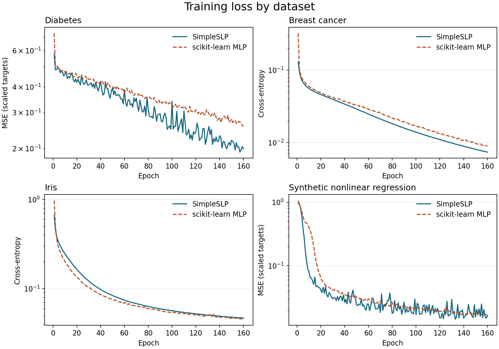
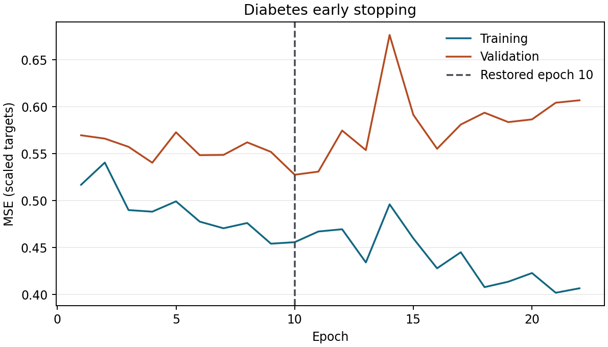

# Single-hidden-layer neural network

The project implements a classifier and a regressor with one hidden layer. Both expose `fit`, `predict`, `score`, `get_params`, and `set_params`. The classifier also exposes `predict_proba`, with one column per label in `classes_` order. NumPy performs the forward pass, backpropagation, and parameter updates. Scikit-learn supplies estimator conventions, input checks, and score methods.

## Forward pass and gradients

For a batch of size $m$, the hidden preactivation is $Z_1 = XW_1 + b_1$, and the hidden output is $A_1 = f(Z_1)$. The next affine transformation is $Z_2 = A_1W_2 + b_2$. The hidden activation can be logistic, tanh, ReLU, or identity.

| Task | Output | Batch objective | Output gradient $D_2$ |
| --- | --- | --- | --- |
| Binary classification | One sigmoid unit | Mean binary cross-entropy | $(P-Y)/m$ |
| Multiclass classification | One softmax unit per class | Mean categorical cross-entropy | $(P-Y)/m$ |
| Regression | Linear units | Mean squared error | $2(P-Y)/(mq)$ |

Here $P$ is the prediction, $Y$ is the target, and $q$ is the number of regression outputs. Binary targets are encoded as 0 and 1. Multiclass targets are one-hot encoded. For both classification objectives, differentiating cross-entropy composed with the output activation simplifies the gradient to the prediction residual. Cross-entropy is evaluated directly from logits during training. Softmax subtracts each row's maximum before exponentiation.

The hidden gradient is $D_1 = (D_2 W_2^{\mathsf T}) \odot f'(Z_1)$. The weight gradients are $X^{\mathsf T}D_1$ and $A_1^{\mathsf T}D_2$. Each bias gradient sums its corresponding $D$ over the batch. A finite-difference test checks all four parameter arrays for binary classification, multiclass classification, and two-output regression.

## Optimization

Weights start from a Glorot uniform distribution and biases start at zero. Each epoch shuffles the optimization rows, then updates all arrays from each mini-batch. With momentum, the update is $v \leftarrow \mu v - \eta g$ followed by $\theta \leftarrow \theta + v$. The default $\mu=0$ yields ordinary SGD. Setting `batch_size=None` uses one full-batch update per epoch. Training loss is evaluated on all optimization rows after each epoch.

With early stopping enabled, the estimator sets aside a seeded random validation subset. A validation loss improvement greater than `tol` resets patience. When patience runs out, the model restores the parameters with the lowest observed validation loss. Regression learns target means and scales from the optimization rows, uses those statistics for validation, and converts predictions back to the original target units. The regression loss curve therefore represents MSE in standardized target units.

## Demonstration

Each experiment uses a seeded 75/25 train/test split, stratified for classification. The main comparisons fit feature standardization on the outer training split. Diabetes is loaded with its original feature scales. Both models use 24 tanh units, batch size 16, constant learning rate 0.02, classical momentum 0.8, and a fixed 160-epoch budget. The scikit-learn reference uses SGD with zero L2 penalty. For regression, the reference also standardizes targets using training statistics. The synthetic dataset contains 650 rows of three independent uniform features on $[-2,2]$, with target $\sin(2x_1) + 0.5x_2x_3 + \epsilon$ and Gaussian noise of standard deviation 0.1.

| Dataset | Held-out metric | SimpleSLP | scikit-learn MLP |
| --- | --- | ---: | ---: |
| Diabetes | R² | 0.1580 | 0.2957 |
| Breast cancer | Accuracy | 0.9790 | 0.9720 |
| Iris | Accuracy | 0.9474 | 0.9474 |
| Synthetic nonlinear regression | R² | 0.9818 | 0.9811 |



The breast cancer, Iris, and synthetic regression scores are close on these held-out samples. Diabetes has the largest gap, and its training loss continues falling despite the lower held-out R². In a supplementary Diabetes run, the custom model used 20% of the outer training rows for validation and a patience of 12 epochs. It stopped at epoch 22, restored epoch 10, and scored 0.4823 on the same test rows. Feature and target scaling statistics were computed only on the rows used to update the weights. Validation selected the checkpoint. The test split was used for scoring only. The results describe one split per dataset, and the early-stopped run also used fewer optimization rows.



The comparison plot doubles scikit-learn's half-squared-error values to show MSE for both regression implementations. The reference aggregates its batch losses during each epoch. SimpleSLP evaluates loss at the end of each epoch. The implementations also use different initialization and shuffle sequences, and the same learning rate acts on differently scaled regression gradients. The reference emitted a convergence warning at the fixed epoch cap for each dataset.

## Reproduce

```bash
python -m pip install -r requirements.txt
python -m pytest -q
python demonstrate.py
```

The demonstration prints the held-out scores and regenerates both loss figures. The reported run used Python 3.13, NumPy 2.3.5, scikit-learn 1.9.1, and Matplotlib 3.10.0.
